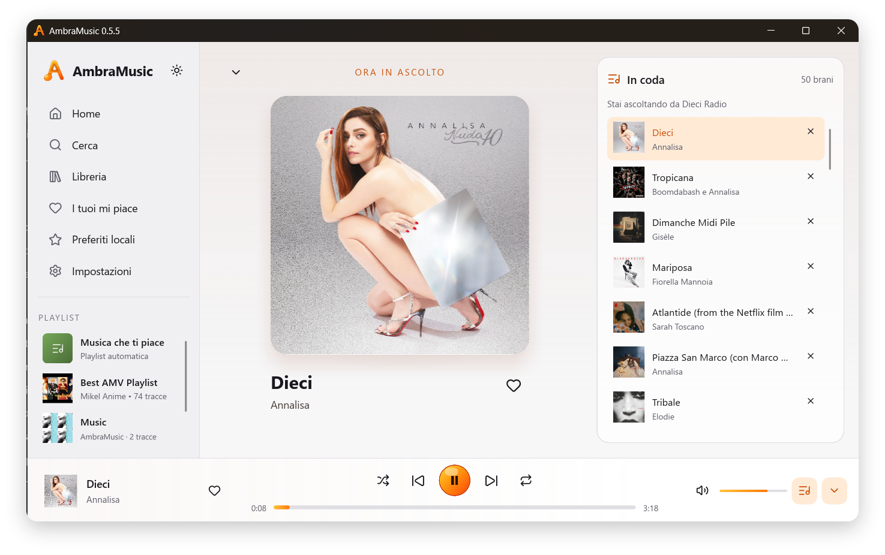
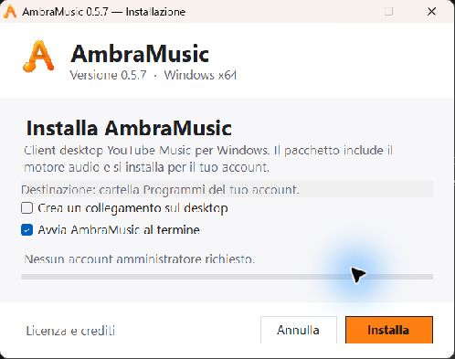
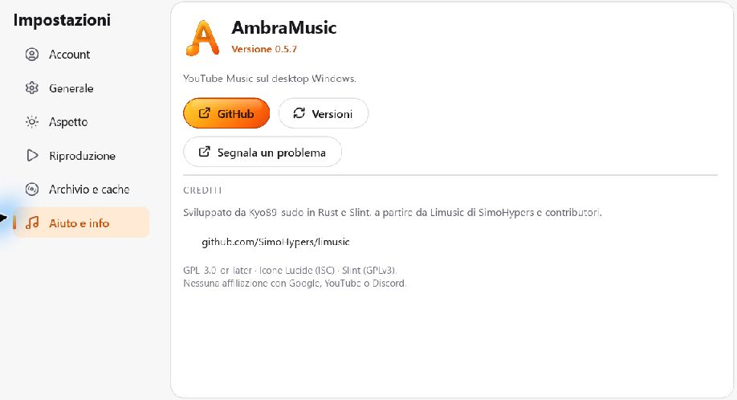

  

<h1 align="center">AmbraMusic</h1>

<strong>Client desktop YouTube Music per Windows, in Rust e Slint.</strong>

  
  
  
  

  <a href="https://github.com/Kyo89-sudo/AmbraMusic/releases/download/v0.5.7/AmbraMusic-Setup-0.5.7-x64.exe">Installer Windows x64</a> ·
  <a href="https://github.com/Kyo89-sudo/AmbraMusic/releases/tag/v0.5.7">Release e sorgenti</a> ·
  <a href="docs/BUILD.md">Compila e prova</a> ·
  <a href="#funzioni">Funzioni</a> ·
  <a href="CHANGELOG.md">Changelog</a> ·
  <a href="https://github.com/Kyo89-sudo/AmbraMusic/issues">Segnala un problema</a>

AmbraMusic è un client desktop indipendente per **YouTube Music**, pensato per Windows e scritto in **Rust e Slint**. Ricerca, raccolta e coda convivono in un’interfaccia dedicata all’ascolto, con temi chiaro e scuro, accenti ambra e sfumature ispirate alle copertine.

Il progetto deriva da [Limusic](https://github.com/SimoHypers/limusic), di cui conserva parte del codice e l’impostazione di alcune funzioni, e prosegue con un’interfaccia Slint e un player basato direttamente su libmpv.

## Anteprima

  

Vista In riproduzione · Tema chiaro · AmbraMusic 0.5.5

Screenshot fornito dall’utente, con nome personale sostituito da “AmbraMusic” e sola cornice editoriale. Copertina, contenuti e controlli dell’interfaccia sono quelli dello screenshot originale.

## Funzioni

| Area | Cosa puoi fare | Approfondisci |
| :--- | :--- | :--- |
| **Ricerca e scoperta** | Cerca con suggerimenti e filtri; esplora Home, playlist, album e artisti. | [Ricerca e navigazione](docs/USO.md#ricerca-e-navigazione) |
| **Player e coda** | Riproduci, metti in pausa, salta, regola volume e posizione; usa shuffle, ripeti e continuazione automatica. | [Riproduzione e coda](docs/USO.md#riproduzione-e-coda) |
| **Raccolta e preferiti** | Accedi a playlist e brani piaciuti dell’account; gestisci i preferiti locali anche senza accesso. | [Raccolta e preferiti](docs/USO.md#raccolta-e-preferiti) |
| **Copertine e temi** | Scegli tema chiaro o scuro e apri la vista In riproduzione con copertina grande e sfondo armonizzato. | [Aspetto e copertine](docs/USO.md#aspetto-e-copertine) |
| **Accesso Google** | Collega l’account in una finestra dedicata, salva la sessione su Windows o usa il Cookie header avanzato. | [Account e sessione](docs/USO.md#account-e-sessione) |
| **Commenti** | Leggi e ordina i commenti, espandi le risposte e usa le interazioni disponibili per l’account collegato. | [Commenti](docs/USO.md#commenti) |
| **Area di notifica** | Continua l’ascolto dalla tray; richiama la finestra e usa i comandi del menu. Un secondo avvio richiama l’istanza esistente. | [Finestra e area di notifica](docs/USO.md#finestra-e-area-di-notifica) |
| **Discord Rich Presence** | Mostra il brano in ascolto sul profilo Discord e attiva o disattiva l’integrazione dalle Impostazioni. | [Discord](docs/USO.md#discord) |
| **Demo** | Esplora l’interfaccia con dati di esempio senza collegare un account. | [Compilazione e demo](docs/BUILD.md#compilazione-guidata) |

La tabella descrive le funzioni implementate; i controlli effettivamente eseguiti sono documentati in [VERIFICA.md](VERIFICA.md).

## Inizia da qui

Questa distribuzione contiene **i sorgenti completi**. Non è un installer Windows e non include un eseguibile release verificato in questa sessione.

1. Scarica **[AmbraMusic-Setup-0.5.7-x64.exe](https://github.com/Kyo89-sudo/AmbraMusic/releases/download/v0.5.7/AmbraMusic-Setup-0.5.7-x64.exe)**.
2. Chiudi eventuali istanze già aperte scegliendo **Esci** dall’icona nell’area di notifica.
3. Avvia l’installer e scegli **Installa**. Il collegamento desktop è opzionale; l’app viene aggiunta al menu Start.

L’installer opera sul tuo account e non richiede privilegi amministrativi. Per l’accesso Google serve WebView2 Runtime. Il pacchetto non è firmato con un certificato Authenticode.

Per compilare da sorgente usa `COMPILA-WINDOWS.cmd`; per generare anche l’installer usa `CREA-INSTALLER.cmd`.

[Guida all’installazione](docs/INSTALLAZIONE.md) · [Compilazione](docs/BUILD.md) · [Funzioni](docs/USO.md)

## Novità della 0.5.7

Prima distribuzione con installer Windows dedicato: interfaccia e motore di installazione scritti per AmbraMusic, aggiornamento per utente e disinstallazione selettiva. Il pacchetto include eseguibile, motore audio e licenze.

La patch compatta Aiuto e info, rende scorrevoli i menu nelle finestre basse e corregge lo spazio dei dati del brano in In riproduzione. I suggerimenti di ricerca non coprono più i comandi del player.

Aiuto e info nella 0.5.7

Ritaglio della finestra Windows reale al 125%, limitato alla sezione delle impostazioni.

[Installazione](docs/INSTALLAZIONE.md) · [Changelog](CHANGELOG.md) · [Note di release](docs/RELEASE-0.5.7.md) · [Confronto con la 0.5.6](https://github.com/Kyo89-sudo/AmbraMusic/compare/v0.5.6...v0.5.7)

## Verifiche e stato del progetto

| Controllo | Esito e ambito | Cosa dimostra |
| :--- | :--- | :--- |
| Controllo di compilazione Rust e Slint | Superato | Codice e UI compilabili con `cargo check`; nessun avviso di codice inutilizzato. |
| Logica Discord, invariata | 25 test superati nella 0.5.5 | Test sul modulo originale con dipendenze reali in un progetto di test isolato. |
| Geometria DPI e taskbar | 3 test superati nella 0.5.6 | Scale comuni, incluso 125%, e monitor con coordinate negative. |
| Layout UI 0.5.7 | 5 configurazioni e interazioni verificate | Barra inferiore entro la finestra; prova software headless, senza audio o account. |
| Interfaccia mostrata sopra | Screenshot fornito dall’utente | Aspetto della vista In riproduzione; non sostituisce una verifica di ogni schermata. |
| Build release Windows x64 | Superata | Eseguibile collegato con libmpv; avvio nativo e navigazione nelle impostazioni verificati. |
| Installer personalizzato | 5 prove sul pacchetto reale superate | Installazione, aggiornamento, disinstallazione selettiva, rifiuto cartelle estranee e collegamenti; prove isolate. |

AmbraMusic è una **beta in sviluppo**. La priorità è consolidare l’ascolto e correggere problemi riproducibili, mantenendo il lavoro per versioni successive. Il [rapporto di verifica](VERIFICA.md) distingue i controlli attuali da quelli storici.

### Limiti noti

- La riproduzione dipende dalle risposte di YouTube Music; alcuni brani o sessioni possono richiedere ulteriori correzioni del client.
- Non è disponibile la scelta del canale per account con più canali YouTube.
- Testi sincronizzati, video, modifica delle playlist, tasti multimediali di sistema e aggiornamenti automatici non sono inclusi.
- Linux è un ambiente di sviluppo secondario; l’accesso Google integrato è specifico di Windows.
- Le immagini in `anteprime/` sono storiche; lo screenshot attuale è in `docs/images/`.

## Account e riservatezza

L’accesso si apre dalla pagina **Impostazioni → Account**. Google viene mostrato in una finestra WebView2 separata; AmbraMusic acquisisce i cookie di sessione necessari per collegarsi a YouTube Music. Su Windows la sessione salvata viene cifrata con DPAPI e associata all’utente locale.

Cookie, file di sessione e dati di accesso sono credenziali: non inserirli nelle issue, nei log condivisi o nei commit. I dettagli sono nella [guida account e sessione](docs/USO.md#account-e-sessione).

## Segnalazioni e contributi

Per una segnalazione utile, [apri una issue](https://github.com/Kyo89-sudo/AmbraMusic/issues) con versione di AmbraMusic, versione di Windows, scala DPI, passaggi per riprodurre il problema e risultato atteso. Per difetti grafici aggiungi, se possibile, uno screenshot senza dati personali.

Per proporre un intervento, descrivi prima il problema e mantieni le modifiche circoscritte. I contributi devono rispettare la licenza del progetto e i crediti del codice derivato.

## Tecnologie, crediti e licenza

| Componente | Ruolo | Riferimento |
| :--- | :--- | :--- |
| **Rust** | Logica applicativa e coordinamento dei servizi | [rust-lang.org](https://www.rust-lang.org/) |
| **Slint** | Interfaccia desktop | [slint.dev](https://slint.dev/) |
| **libmpv** | Riproduzione audio tramite API C | [mpv.io](https://mpv.io/) |
| **WebView2** | Finestra di accesso Google su Windows | [Microsoft WebView2](https://developer.microsoft.com/microsoft-edge/webview2/) |
| **Lucide** | Icone dell’interfaccia | [Lucide](https://lucide.dev/) · [licenza inclusa](assets/fonts/LUCIDE-LICENSE.txt) |
| **Limusic** | Progetto di origine e parti di codice derivate | [SimoHypers/limusic](https://github.com/SimoHypers/limusic) |

AmbraMusic è sviluppato da **Kyo89-sudo**, a partire dal lavoro di **SimoHypers e contributori** su Limusic. Provenienza, commit di riferimento e dipendenze sono descritti in [THIRD-PARTY.md](THIRD-PARTY.md).

Il codice è distribuito sotto **GPL-3.0-or-later**: consulta il [testo della licenza](LICENSE). Dipendenze, icone e altri componenti mantengono le rispettive licenze; le copertine musicali mostrate nello screenshot appartengono ai rispettivi titolari.

AmbraMusic è un progetto indipendente e non è affiliato a Google, YouTube o Discord.
